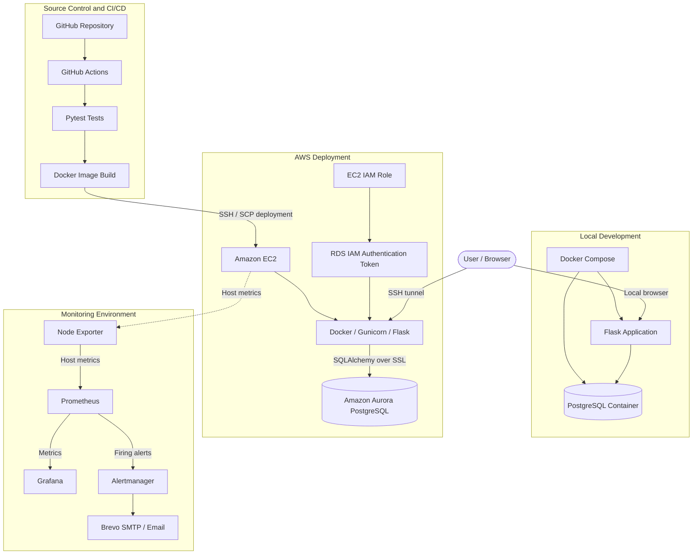

# DevOps Project Tracker — System Architecture

## 1. Architecture Overview

The project uses a containerised Flask application, PostgreSQL and AWS cloud services.

There are two application environments:

- **Local development:** Docker Compose runs Flask and PostgreSQL containers.
- **AWS deployment:** Docker Compose runs the Flask application on EC2, while Amazon Aurora PostgreSQL provides the managed production database.

GitHub Actions automates testing, image building and deployment. A separate monitoring host runs Prometheus, Grafana and Alertmanager.

## 2. Application Architecture Diagram

## 3. Main Components

### Application Layer

The application is developed using Python and Flask.

Its responsibilities include:

- User registration and authentication.
- Project and task management.
- Dashboard summaries.
- Database operations through SQLAlchemy.
- Health reporting through `/health`.

Gunicorn serves the Flask application inside the Docker container.

### Database Layer

The database configuration depends on the environment.

| Environment | Database | Authentication |
|---|---|---|
| Local | PostgreSQL Docker container | Username and password |
| AWS | Amazon Aurora PostgreSQL | AWS IAM database authentication |

In AWS, the application uses Boto3 to generate an RDS authentication token when establishing database connections. Database connections require SSL.

### Cloud and Deployment Layer

Amazon EC2 hosts the production application container.

GitHub Actions connects to EC2 using SSH and transfers the application package. Docker Compose then rebuilds and starts the application container.

The production database is managed separately by Amazon Aurora.

### Monitoring Layer

The monitoring environment contains:

- **Node Exporter:** Exposes Linux host metrics.
- **Prometheus:** Collects metrics and evaluates alert rules.
- **Grafana:** Displays metrics through dashboards.
- **Alertmanager:** Handles firing alerts and notification routing.
- **Brevo SMTP:** Delivers email notifications.

## 4. Application Access

The production application listens on `127.0.0.1:5000` on the EC2 host.

Access is provided through an SSH local port-forwarding tunnel. The application port is not directly exposed as a public web endpoint.

Grafana, Prometheus and Alertmanager are also configured for local access on the monitoring host and can be reached through SSH tunnels.

## 5. Infrastructure as Code

The Module 6 Terraform configuration uses an AWS EC2 data source to inspect an existing EC2 instance and expose selected attributes as outputs.

This demonstrates Terraform resource discovery. It does not create or modify the production application or monitoring infrastructure.

## 6. Architecture Notes and Limitations

- Local and production environments use different database authentication methods.
- Production uses a managed Aurora database rather than a PostgreSQL container.
- The application and monitoring interfaces are accessed through SSH tunnels.
- The production deployment uses an existing EC2 host and existing Aurora database.
- The monitoring host shares an EC2 security group with broad inbound permissions. This is a known security limitation that requires review.
