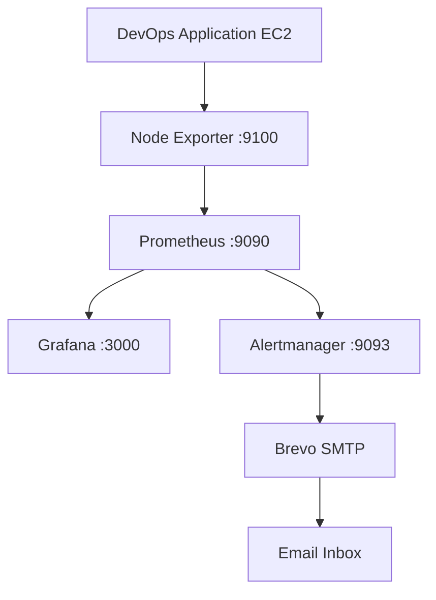

# DevOps Project Tracker — Monitoring and Alerting

## 1. Overview

The capstone monitoring environment uses Prometheus, Node Exporter, Grafana and Alertmanager to collect infrastructure metrics, display system health and send email notifications.

Monitoring services run on a dedicated EC2 monitoring host. Their web interfaces listen on localhost and are accessed through SSH tunnels.

## 2. Monitoring Components

| Component | Purpose |
|---|---|
| Prometheus | Collects and stores time-series metrics. |
| Node Exporter | Exposes Linux host metrics such as CPU, memory, filesystem and network usage. |
| Grafana | Displays metrics through dashboards. |
| Alertmanager | Receives alerts and routes notifications. |
| Brevo SMTP | Sends email notifications through the configured SMTP relay. |

## 3. Metrics Collection

Prometheus is configured to scrape:

- Its own metrics endpoint on `127.0.0.1:9090`.
- The Node Exporter endpoint on the DevOps application host at port `9100`.

Node Exporter provides host-level metrics, including CPU, memory, filesystem and network activity.

The Prometheus service is managed by systemd and configured to start automatically.

## 4. Grafana Dashboard

Grafana uses Prometheus as its data source:

`http://127.0.0.1:9090`

The Node Exporter Full dashboard (dashboard ID `1860`) displays:

- CPU utilisation.
- Memory utilisation.
- Filesystem usage.
- Network activity.

Grafana listens on `127.0.0.1:3000`.

## 5. Alert Rules

Three warning-level Prometheus rules are configured:

| Alert | Condition | Duration |
|---|---|---|
| High CPU usage | CPU utilisation above 80% | 5 minutes |
| High memory usage | Memory utilisation above 85% | 5 minutes |
| High root filesystem usage | Root filesystem usage above 85% | 5 minutes |

The rules are loaded by Prometheus. When the thresholds are not exceeded, the alerts remain inactive.

## 6. Alertmanager and Email Notifications

Prometheus sends alerts to Alertmanager through its local API endpoint:

`http://127.0.0.1:9093/api/v2/alerts`

Alertmanager uses the Brevo SMTP relay for email notifications.

A manual test alert was submitted to Alertmanager. The notification was successfully delivered to the configured Gmail inbox, and the test alert was subsequently resolved.

**Testing limitation:** This confirms that Alertmanager can send an email through Brevo. It does not yet confirm a complete end-to-end alert triggered by an actual Prometheus CPU, memory or filesystem threshold breach.

SMTP credentials are stored in protected files on the monitoring host. They must not be committed to Git or included in documentation.

## 7. Accessing Monitoring Interfaces

Prometheus, Grafana and Alertmanager listen on localhost on the monitoring host. Their interfaces are accessed through SSH tunnels.

The following commands are for Windows PowerShell, not WSL.

### Grafana

`ssh -i "$env:USERPROFILE\Desktop\KeyPair\devopstest.pem" -o IdentitiesOnly=yes -L 3000:127.0.0.1:3000 ec2-user@YOUR_MONITORING_EC2_PUBLIC_IP`

Open in your browser: `http://localhost:3000`

### Prometheus

SSH tunnel command (Windows PowerShell):

`ssh -i "$env:USERPROFILE\Desktop\KeyPair\devopstest.pem" -o IdentitiesOnly=yes -L 9090:127.0.0.1:9090 ec2-user@YOUR_MONITORING_EC2_PUBLIC_IP`

Open: `http://localhost:9090`

### Alertmanager

SSH tunnel command (Windows PowerShell):

`ssh -i "$env:USERPROFILE\Desktop\KeyPair\devopstest.pem" -o IdentitiesOnly=yes -L 9093:127.0.0.1:9093 ec2-user@YOUR_MONITORING_EC2_PUBLIC_IP`

Open: `http://localhost:9093`

Replace `YOUR_MONITORING_EC2_PUBLIC_IP` with the monitoring host current public IP. Do not publish that address in this documentation.

## 8. Monitoring Architecture

## 9. Security and Operational Notes

- Monitoring interfaces are accessed through SSH tunnels rather than exposed application URLs.
- Keep SMTP credentials and private SSH keys out of Git.
- Do not publish EC2 public IP addresses or internal infrastructure details unnecessarily.
- The monitoring host reuses an existing shared EC2 security group with broad inbound permissions. This is a known security limitation and should be reviewed before production use.
- The manual email test succeeded, but real threshold-triggered alert delivery still requires end-to-end validation.
